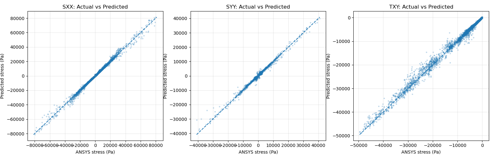

# FEM Surrogate Model for Stress Prediction

A PyTorch-based multilayer perceptron (MLP) that predicts stress components in a 2D cantilever beam using data generated from finite element simulations in ANSYS Mechanical.

The project explores whether a neural network can learn the relationship between spatial coordinates, material properties, applied loading, and the resulting stress field, potentially enabling faster predictions than repeatedly solving the same FEM model.

## Overview

Finite Element Analysis (FEA) is widely used in solid mechanics to calculate displacement and stress fields under specified loading and boundary conditions. However, running repeated simulations can be computationally expensive.

This project develops a data-driven surrogate model trained on ANSYS simulation results. Instead of solving the FEM equations for every new parameter combination, the trained network directly predicts the stress components at a given location.

### Objectives

- Generate a dataset from parametric ANSYS simulations.
- Train a neural network to predict stress components from spatial and physical parameters.
- Evaluate predictive performance on unseen simulation design points.
- Investigate the potential of neural networks as surrogates for repeated FEM evaluations.

## Model Architecture

The model is a fully connected feedforward neural network implemented using PyTorch.

**Input features — 5**

| Feature | Description |
|---|---|
| `X` | Spatial x-coordinate |
| `Y` | Spatial y-coordinate |
| `E` | Young's modulus |
| `nu` | Poisson's ratio |
| `F` | Applied force in the y-direction |

**Output features — 3**

| Output | Description |
|---|---|
| `SXX` | Normal stress component \(\sigma_{xx}\) |
| `SYY` | Normal stress component \(\sigma_{yy}\) |
| `TXY` | In-plane shear stress component \(\tau_{xy}\) |

The network architecture is:

```text
Input (5)
   |
Linear (5 → 128)
   |
ReLU
   |
Linear (128 → 128)
   |
ReLU
   |
Linear (128 → 128)
   |
ReLU
   |
Linear (128 → 3)
   |
Predicted stress components
```

The output layer has no activation function, allowing the network to predict both positive and negative stress values.

## Dataset Generation

The training data was generated using **ANSYS Mechanical**, with a Python-based extraction pipeline using **PyDPF**.

### Simulation setup

- Geometry: 2D cantilever beam
- Mesh: 1,111 nodes
- Number of design points: 500
- Total extracted samples: 555,500 node-level records

The design points vary the material properties and applied force. The geometry and mesh remain fixed.

The extracted dataset contains the following columns:

```text
DP, Node, X, Y, Z, UX, UY, UZ,
E, nu, F, SXX, SYY, TXY
```

Each record corresponds to a node in a particular simulation. The model uses the five input features and predicts the three stress components.

### Data extraction

PyDPF was used to extract nodal coordinates, displacements, and stress components from ANSYS result files. The extraction was checked against Mechanical-exported results, with differences negligible relative to the stress magnitudes in the dataset.

## Data Preprocessing

The 500 design points were divided into three sets using a reproducible random shuffle with seed `42`.

| Dataset | Design points | Proportion |
|---|---:|---:|
| Training | 400 | 80% |
| Validation | 50 | 10% |
| Test | 50 | 10% |

Splitting was performed **by design point**, rather than randomly by node. This ensures that nodes from a given simulation cannot appear in both the training and test sets.

The input features and target stress components were standardized independently using `StandardScaler`.

- Scalers were fitted only on the training set.
- The fitted scalers were applied to the validation and test sets.
- Predictions were inverse-transformed before evaluation so that errors could be reported in Pascals.

## Training

The network was trained using PyTorch.

| Parameter | Value |
|---|---|
| Hidden layers | 3 |
| Hidden units per layer | 128 |
| Hidden activation | ReLU |
| Loss function | Mean Squared Error (MSE) |
| Optimizer | Adam |
| Learning rate | 0.001 |
| Batch size | 2,048 |
| Training epochs | 50 |

Training used mini-batches. For each batch, the model performed forward propagation, calculated the loss, computed gradients through backpropagation, and updated its parameters using Adam.

Validation loss was calculated after each epoch without updating the model parameters. The model checkpoint with the lowest validation loss was saved as `best_model.pth`.

## Results

The model was evaluated on 50 held-out design points that were not used for training or validation.


### Test-set metrics

| Stress component | MAE (Pa) | RMSE (Pa) | \(R^2\) |
|---|---:|---:|---:|
| SXX | 181.96 | 418.15 | 0.99558 |
| SYY | 42.37 | 162.60 | 0.98737 |
| TXY | 127.87 | 301.88 | 0.99432 |

### Interpretation

- All three stress components achieved \(R^2\) scores above 0.987 on the held-out test set.
- Actual-versus-predicted scatter plots showed strong agreement between the neural network and ANSYS results.
- SYY had the lowest \(R^2\) and therefore warrants closer investigation, particularly in regions where the actual stress magnitude is small.
- The results indicate that the network learned useful relationships within the parameter space represented by the simulation dataset.

The model has not yet been established as a replacement for FEM. Its accuracy outside the sampled parameter ranges, on different geometries, or under different boundary conditions remains untested.

## Repository Structure

```text
fem-surrogate-mlp/
├── model.py
├── data_processing.py
├── train.py
├── evaluation.py
├── README.md
├── requirements.txt
├── results/
│   └── actual_vs_predicted.png
├── beam_dataset_dpf.csv    # Local dataset; not necessarily committed
└── best_model.pth          # Saved model checkpoint
```

The dataset and checkpoint may be excluded from version control because of their size. If they are not included in the repository, users must generate or obtain them separately.

## Installation

Clone the repository:

```bash
git clone https://github.com/Aryaman-007/neural-fem-stress-prediction.git
cd neural-fem-stress-prediction
```

Create and activate a virtual environment:

```bash
python -m venv .venv
```

On Windows PowerShell:

```powershell
.venv\Scripts\Activate.ps1
```

Install the dependencies:

```bash
pip install -r requirements.txt
```

The project uses Python, PyTorch, NumPy, Pandas, scikit-learn, Matplotlib, and tqdm.

## Running the Project

The following commands assume the dataset and saved checkpoint are available locally.

**1. Prepare the dataset**

```bash
python data_processing.py
```

This loads the extracted dataset, creates the design-point split, fits the scalers, and prepares the PyTorch tensors and data loaders.

**2. Train the model**

```bash
python train.py
```

This trains the MLP and saves the best-performing model checkpoint.

**3. Evaluate the model**

```bash
python evaluation.py
```

This loads the checkpoint, predicts stress components for the test set, inverse-transforms the predictions, and calculates MAE, RMSE, and \(R^2\).

The scripts may need to be adjusted if data loading, training, or checkpoint-saving logic is implemented differently in your local version.

## Limitations and Future Work

Current limitations:

- The model is trained for a single beam geometry and fixed mesh.
- Generalization to other geometries, meshes, boundary conditions, or loading configurations has not been demonstrated.
- Accuracy outside the sampled material-property and force ranges is unknown.
- Stress prediction errors may be larger near localized stress concentrations or in regions with low stress magnitudes.
- Inference-speed improvements over ANSYS have not yet been benchmarked.

Potential future improvements:

- Visualize ANSYS and neural-network stress fields over the beam geometry.
- Compare NN inference time against FEM solve time.
- Implement early stopping and systematic hyperparameter tuning.
- Analyze errors by design point and spatial location.
- Investigate physical constraints and the linear relationship between load magnitude and stress under linear-elastic assumptions.
- Extend the approach to additional geometries or structural problems.

## Technologies Used

- Python
- PyTorch
- NumPy and Pandas
- scikit-learn
- Matplotlib
- ANSYS Mechanical
- Ansys PyDPF

## Motivation

This project was developed to explore the intersection of solid mechanics, finite element analysis, and machine learning, with an emphasis on understanding neural-network training and evaluating the practical limitations of data-driven surrogate models.
